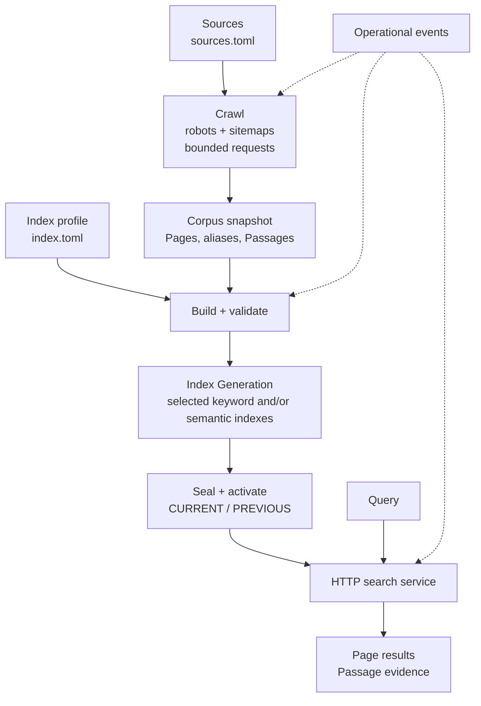

# Scout

Scout is a single-node Rust search service for explicitly allowlisted technical documentation.
It crawls Sources, publishes immutable Corpus snapshots, builds validated keyword-only,
semantic-only, or hybrid Index Generations, then serves Page-level results with Passage evidence.

```text
sources.toml
  crawl + robots.txt/sitemap discovery + bounded retries
  -> immutable Corpus snapshot: Pages, aliases, Passages
data/config/index.toml
  -> Index Generation: selected Tantivy keyword and/or USearch vector indexes
  -> atomic activation through CURRENT
  -> HTTP search
```

## Technical implementation



Modules group code by domain:

- `src/crawl/` owns config, fetching, robots and sitemap policy, extraction, spooling, and crawl
  orchestration. Fetching uses blocking `reqwest`, bounded retries, politeness spacing, and safety caps.
- `src/corpus/` materializes immutable Pages, exact-content aliases, and heading-bounded Passages;
  IDs and artifact ordering are deterministic. Repeated final URLs use a recorded lexical capture
  selection key, so conflicting responses are explainable without arrival-order dependence.
- `src/generation/` builds Tantivy keyword fields plus a USearch cosine index. `fastembed` provides
  BGE-small embeddings; deterministic embeddings exist only for tests. Manifests, catalogs, counts,
  identities, and SHA-256 checksums are reopened and fully validated before build success or activation.
- `src/distributed/` separates coordinator, worker, RPC protocol, and persistent frontier.
- `src/http/` exposes the JSON API through `TcpListener` and a small HTTP/1.1 implementation;
  `src/observability.rs` writes structured operational events and optional NCSA access logs.
- `src/evaluation/` and `src/benchmark/` enforce frozen inputs, relevance metrics, paired bootstrap
  diagnostics, replayable staging runs, latency distributions, and integrity evidence.
- `src/app.rs` dispatches operations; `src/lib.rs` wires modules.

## Quick start

Requires Rust/Cargo. Crawling needs network access. The `fastembed` backend downloads and caches
`BAAI/bge-small-en-v1.5`; use the deterministic backend only for fixtures and contract tests.

```bash
cargo build --release
BIN=target/release/scout
DATA=data

$BIN crawl --config sources.toml --data-dir "$DATA"
# Copy snapshot_id from the crawl output into data/config/index.toml.
$BIN index build --corpus <snapshot-id> --data-dir "$DATA" --mode hybrid
$BIN index activate --generation <generation-id> --data-dir "$DATA"
$BIN serve --data-dir "$DATA" --bind 127.0.0.1:8080
```

`data/config/index.toml` is mandatory and intentionally explicit. It pins the Corpus snapshot,
extraction and Passage schemas, Tantivy boosts, model provenance, embedding backend, USearch
parameters, and reciprocal-rank-fusion settings. No default profile is generated.

Minimal `sources.toml`:

```toml
schema_version = "scout.sources.v1"
contact_url = "https://example.com/contact"
user_agent = "Scout/0.1 (+https://example.com/contact)"
page_target = 1000

[[sources]]
source_id = "rust"
seeds = ["https://doc.rust-lang.org/book/"]
allowed_origins = ["https://doc.rust-lang.org"]
path_prefixes = ["/book/"]
```

Each Source needs seeds, allowed Origins, and absolute path boundaries. The crawler normalizes
URLs, obeys robots policy, follows same-allowlist redirects, discovers same-Origin sitemaps,
limits frontier/request/body/time budgets, and records structured JSONL events.
Optional `allowed_urls` restricts page ownership to exact normalized URLs, including discovered
links, sitemap entries, and redirect targets.

## Observed 10k crawl and build

Run19's narrow URL scopes stopped at 3,826 Pages. Run20 widened Python paths to versions 3.10–3.14
and PostgreSQL scope to documentation pages, then created a 10,005-Page Corpus with 145,008
Passages and activated a BGE Small Generation using the OpenVINO GPU provider. Run20 records wall
time and RAM, but not CPU utilization, CPU time, GPU utilization, or GPU memory. Resource roles below
describe the code path and selected provider; they do not prove a stage was CPU-bound or GPU-bound.

| Stage | Work and resource role | Run20 evidence |
|---|---|---|
| Preflight | Check source/index profiles, snapshot identity, model assets, and available memory. CPU; no GPU inference. | Build launch gate: at least 6 GiB WSL `MemAvailable`; successful run started with about 6.3 GiB. |
| Discover and fetch | Read robots/sitemaps and seeds, schedule URLs, fetch pages, extract text and links. Network plus CPU; no GPU. | Configured global concurrency 8, one request per Origin; actual peak was 4 requests across 4 Origins. Target reached 03:54:17 UTC; snapshot completion logged 03:56:35 UTC. Crawl recorded 12,976 captures, 10,005 Pages, 2,905 aliases, and 145,008 Passages. |
| Materialize Corpus | Resolve duplicate captures, create and validate Pages/Aliases/Passages, serialize records, hash files, write manifests, and seal snapshot. CPU, RAM, and disk; no GPU. | Largest observed crawl RAM phase: about 2.6 GiB Scout RSS and 1.6 GiB WSL available; swap stayed unused. |
| Read and build catalog | Read and validate snapshot JSONL, sort and normalize Passages, create catalog and vector keys. CPU, RAM, and disk; no GPU. | Final catalog is about 397 MiB. Per-stage RAM was not recorded. |
| Build keyword index | Add each Passage to Tantivy and commit index. CPU and disk; no GPU. | One worker, 16,000,000-byte writer budget, 145,008 documents; artifact about 151 MiB. Exact stage time and RAM were not saved. |
| Load model and embed | Prepare heading-plus-text input and embed Passages with BGE Small. OpenVINO GPU selected for inference; CPU handles surrounding preparation. | Model initialization 1.32s; batch size 4, one embedding worker, one intra-op thread, 384 dimensions. Embedding took 20m58s across 1,115 calls; full semantic stage took 22m36s at a reported 106.9 Passages/s. Other semantic work was 32.56s. GPU use and memory were not sampled. |
| Write vectors and build semantic index | Write float vectors, add vectors to USearch, save and reopen index. CPU, RAM, and disk for writes/index work; no GPU inference. | Vector writes 19.36s; USearch insertion 40.28s; flush under 1ms; persistence 3.89s; reopen validation 0.014s. USearch artifact about 233 MiB. |
| Validate semantic output | Check vectors and reopened index; embed one test query and run smoke search. CPU for checks/search; selected GPU provider for the test-query embedding. | Vector validation 0.53s; query embedding 0.02s; smoke search 0.08s; reopen validation 0.014s. |
| Finalize Generation | Write manifest/checksums, then reopen catalog and indexes and check identities, counts, and hashes. CPU, RAM, and disk; no GPU inference. | Full validation caused late memory stops after Passage embedding had finished. This is a separate build phase, not another embedding pass. |
| Activate and smoke-test | Activate validated Generation, run `index verify`, then check HTTP health, readiness, Generation metadata, and hybrid search. CPU and disk; hybrid search uses selected GPU provider for query embedding. | All four HTTP checks returned 200. Resource use was not sampled. |

The builder's resource guard sampled process RSS, WSL available memory, swap, and disk every 2 seconds. It did not sample CPU or GPU. Attempts 1 and 2 stopped before the long embedding stage at 2 GiB and 2.5 GiB RSS caps; Attempt 1 was during keyword indexing. Attempt 3 ran for about 23m58s, peaked at 2.53 GiB RSS, and hit its 2.5 GiB guard during final validation. Attempts 4 and 5 retried validation and hit the 4 GiB available-memory floor. Attempt 6 released duplicate catalog data and validated the already-built artifacts in 68 seconds, peaking at 1.61 GiB RSS with 4.68 GiB minimum available and no swap-out. **That 68-second resume was not a fresh full build, so it does not establish full-build peak RAM after the fix.** Attempt-by-attempt evidence and exact limits: [Run20 report](docs/runs/run-20-10k-rebuild-v2-2026-09-30.md).

For future 10k Generation builds, the reusable process-tree RSS ceiling is now 4 GiB; the existing available-memory and swap stops remain active. The earlier attempt caps above are historical and unchanged. See [Run22](docs/runs/run-22-ticket-23-evaluation-freeze-2026-10-01.md).

For speed work, measure each phase first. Roadmap section 6 proposes per-Origin crawl canaries and controlled embedding batch-size comparisons; CPU/GPU telemetry is needed before deciding which resource limits throughput.

## CLI

```text
scout crawl --config <sources.toml> --data-dir <dir> [--json]
scout coordinator --config <sources.toml> --data-dir <dir> [--bind <private-address>] [--run-id <crawl-run-id>]
scout worker --coordinator <http://address:port> --data-dir <dir> [--worker-id <id>]
scout index build --corpus <snapshot-id> --data-dir <dir> [--mode <hybrid|semantic-only|keyword-only>] [--json]
scout index activate --generation <generation-id> --data-dir <dir> [--json]
scout index recover --data-dir <dir> [--json]
scout index verify --data-dir <dir>
scout index prune --data-dir <dir> [--retain <generation-id>]... [--json]
scout serve --data-dir <dir> --bind <address> [--access-log <path>]
scout evaluate --package <dir> --data-dir <dir>
scout benchmark --config <benchmark.toml> --data-dir <dir>
```

`index build` defaults to `keyword-only` and writes a validated Generation under staging. Use
`--mode hybrid` to build both indexes. `keyword-only` Generations support keyword search;
`semantic-only` Generations support semantic search. Requests for unavailable search modes fail
explicitly. `index activate` seals a Generation, verifies
checksums/counts/identity, and atomically updates `CURRENT`; the previous valid Generation is
kept through `PREVIOUS`. `recover`, `verify`, and `prune` manage that lifecycle.

The crawl/build scripts accept the same three arguments (`sources.toml`, index profile template,
data directory): `scripts/crawl-build-coreml.sh` builds hybrid, `scripts/crawl-build-semantic-only-coreml.sh`
builds semantic-only, and `scripts/crawl-build-keyword-only.sh` builds keyword-only without CoreML.

Distributed crawl uses PostgreSQL only on `scout coordinator`; set `SCOUT_DATABASE_URL` in that
process environment. Bind coordinator to a loopback, private, link-local, or Tailscale address.
Workers receive no database connection settings and connect over the private network:

```bash
SCOUT_DATABASE_URL='postgresql://…' scout coordinator --config data/configs/sources-500.toml --data-dir ./data/distributed --bind 100.64.0.10:50051
scout worker --coordinator http://100.64.0.10:50051 --data-dir ./data/worker-a
```

Coordinator and worker negotiate protocol version 1 at registration. Tailnet ACLs control access;
the RPC service has no application credentials. Each worker processes one leased URL at a time,
renews its fenced lease, and obtains shared request permits for page, redirect, robots, and sitemap
requests. Captures are validated and reported to the coordinator; durable capture acceptance and
Corpus materialization are Ticket 4 work.

## HTTP API

```bash
curl http://127.0.0.1:8080/v1/healthz
curl http://127.0.0.1:8080/v1/readyz
curl http://127.0.0.1:8080/v1/generation

curl -X POST http://127.0.0.1:8080/v1/search \
  -H 'content-type: application/json' \
  -d '{"query":"ownership and borrowing","mode":"hybrid","limit":10}'
```

Search modes: `keyword`, `semantic`, `hybrid` (default). Optional `source` filters by Source.
Responses include active Generation and Corpus snapshot IDs. Results are grouped by Page and
include the winning Passage ID, heading path, URL, score, title, and bounded snippet.

Routes:

- `GET /v1/healthz` — process health.
- `GET /v1/readyz` — readiness backed by a valid active or recovered Generation.
- `GET /v1/generation` — active Generation metadata and artifact counts.
- `POST /v1/search` — Page-level retrieval.

## Evaluation and benchmarks

Evaluation packages contain `metadata.json`, `queries.jsonl`, and `judgments.jsonl`, with optional
rankings. The evaluator enforces the frozen 64-query package, Page-level 0–3 judgments, and
reports nDCG@10, MRR@10, Recall@100, split diagnostics, and paired-bootstrap intervals.

Benchmark runs lock Corpus, Generation, build/model, evaluation, and Reference-profile provenance.
They can replay frozen local Crawl payloads, measure crawl/index/search phases, and write integrity,
latency, resource, and operational evidence under `data/benchmarks/<run-id>/`. Resource evidence is
independently sampled from `/proc`/`df` and retained as `resource-config.json`, timestamped
`resource-samples.jsonl`, `resource-boundaries.jsonl`, and a reproducible `resource-summary.json`;
set `resource_sampling_interval_ms` (default `100`) in the benchmark config when needed. Pilot
Smoke runs check correctness and harness behavior; MVP performance targets come from the real MVP baseline.

## Data layout

```text
data/
  crawls/<run-id>/
  corpora/<snapshot-id>/
  config/index.toml
  generations/.staging/<run-id>/
  generations/<generation-id>/
  CURRENT
  PREVIOUS
  models/
  logs/<run-id>.jsonl
  evaluations/<run-id>/
  benchmarks/<run-id>/
    resource-config.json
    resource-samples.jsonl
    resource-boundaries.jsonl
    resource-summary.json
```

## Development

```bash
cargo test --offline
```

The HTTP server is intentionally minimal: no TLS, authentication, rate limiting, or multi-node
coordination. Bind it to a trusted interface or place it behind an appropriate edge proxy.
