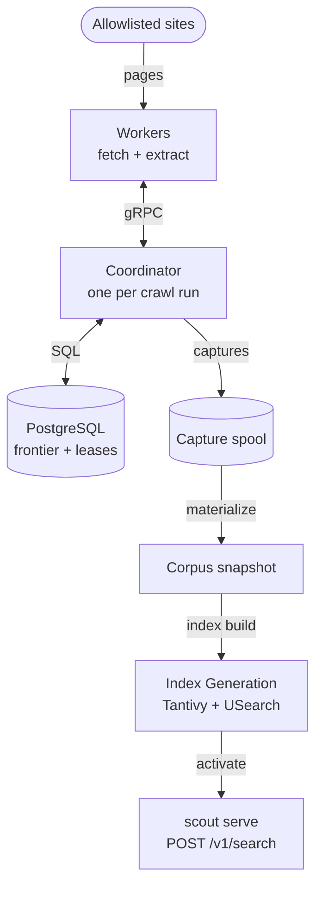

# Scout

[](https://github.com/lifrocszh/scout/actions/workflows/ci.yml)
[](https://github.com/lifrocszh/scout/actions/workflows/e2e-kind.yml)
[](https://github.com/lifrocszh/scout/actions/workflows/image.yml)

Scout crawls allowlisted technical documentation and serves keyword, semantic, or hybrid search
results through an HTTP API. Crawls produce immutable snapshots; search indexes are built from a
snapshot and activated separately.

## How it fits together



Postgres hands each crawl task to a worker as a lease that it fences, so a stalled worker cannot
overwrite its replacement. A finished crawl becomes an immutable snapshot, a snapshot becomes an
index Generation (BM25 keyword plus BGE Small vectors, searched as keyword, semantic or hybrid RRF),
and `serve` switches to a new Generation atomically. The same image runs every role, under Docker
Compose ([Quickstart](#quickstart)) or the Helm chart on Kubernetes
([docs/kubernetes.md](docs/kubernetes.md)).

Left out of the picture:

- **Metrics.** The coordinator, workers and `serve` all expose `/metrics` for Prometheus and
  Grafana ([Observability](#observability)).
- **Optional.** Postgres also holds an event outbox that `scout events consume` can deliver,
  at least once, to a Databricks Delta pipeline ([Phase 2](docs/phase2.md)).
- **Local lakehouse.** Snapshots and outbox events land as Delta tables on the local filesystem,
  with data-quality checks and lineage, and DuckDB queries them. It needs no server or cloud
  account ([docs/lakehouse.md](docs/lakehouse.md)).
- **Optional Kafka log.** `scout kafka relay` copies that outbox into Apache Kafka, and
  `scout kafka reduce` rebuilds the snapshot from Kafka alone and checks it against the live one
  ([Kafka ingestion log](#kafka-ingestion-log-optional), [ADR 0003](docs/adr/0003-kafka-ingestion-log.md)).
  Postgres stays the authority; nothing waits for Kafka. The lakehouse does not read from Kafka
  yet; its event sources are pluggable, so it could.

Why it is built this way (leases and fencing, Postgres instead of a broker, delivery guarantees):
[docs/design.md](docs/design.md). Components and the crawl flow:
[ADR 0002](docs/adr/0002-coordinator-led-distributed-crawling.md).

## Quickstart

Needs Docker with Compose v2. No Rust toolchain.

```bash
git clone https://github.com/lifrocszh/scout.git && cd scout
cp .env.example .env                    # the example password is fine for a local run
docker compose up -d --scale worker=3   # crawl, index and serve the bundled fixture site
```

The first run builds the image from the `Dockerfile`: about 5 minutes on 4 cores. Compose first
tries to pull `scout:local` and prints a harmless "pull access denied" or "failed to resolve" line
before it builds. Once the image exists, the stack takes about 15 seconds to crawl the fixture
site, build a keyword-only index and start serving. To skip the build, use the published `linux/amd64` image:
`SCOUT_IMAGE=ghcr.io/lifrocszh/scout:latest docker compose up -d --no-build --scale worker=3`.

Then search. `"mode":"keyword"` is required: the default `hybrid` fails on a keyword-only index.

```bash
curl http://127.0.0.1:8080/v1/readyz
curl -X POST http://127.0.0.1:8080/v1/search -H 'content-type: application/json' \
  -d '{"query":"rebalance consumer group","mode":"keyword"}'
```

The first hit is the "Tutorial: scaling consumers" page. `docker compose down -v` stops the stack
and deletes its volumes. [Run with Docker](#run-with-docker) covers hybrid search, state, ports and
other crawls.

## Build and run from source

Requires Rust/Cargo. Crawling needs network access. Semantic and hybrid indexing downloads and
caches the BGE Small embedding model on first use.

1. Build Scout:

   ```bash
   cargo build --release
   ```

2. Create a `sources.toml` file that lists the sites Scout may crawl. Each source needs seeds,
   allowed origins, and path prefixes. See [`data/configs/sources-500.toml`](data/configs/sources-500.toml)
   for an example. Scout respects `robots.txt` and stays within the configured URL boundaries.

   Set request budgets in the same TOML. Top-level `origin_concurrency` and
   `min_start_spacing_ms` apply to every allowed origin unless `[[origins]]` overrides them:

   ```toml
   global_concurrency = 8
   origin_concurrency = 1
   min_start_spacing_ms = 500

   [[origins]]
   origin = "https://doc.rust-lang.org"
   origin_concurrency = 2
   min_start_spacing_ms = 1000

   [[origins]]
   origin = "https://docs.python.org"
   min_start_spacing_ms = 750
   ```

   Omitted top-level spacing defaults to 500 ms (at most two starts per second per
   origin); set `min_start_spacing_ms = 0` explicitly to disable spacing.
   Concurrency caps simultaneous requests independently of start spacing. Each
   `origin` must match an allowed scheme, host, and port. Omitted fields inherit
   top-level values. `global_concurrency` caps all requests. Budgets cover page,
   `robots.txt`, sitemap, redirect, and retry requests. Sources sharing a
   `politeness_group` use the strictest member spacing for group starts. Local
   crawls also cap combined requests in that group at top-level
   `origin_concurrency`; distributed crawls cap concurrency per origin.

3. Crawl, build an index, activate it, and start the API:

   ```bash
   BIN=target/release/scout
   DATA=./data

   $BIN crawl --config sources.toml --data-dir "$DATA"
   # Set snapshot_id in data/config/index.toml to the ID printed by crawl.
   # Use the profile example in data/configs/archive/ as a starting point.
   $BIN index build --corpus <snapshot-id> --data-dir "$DATA" --mode hybrid
   $BIN index activate --generation <generation-id> --data-dir "$DATA"
   $BIN serve --data-dir "$DATA" --bind 127.0.0.1:8080
   ```

The index profile is required and pins the snapshot, extraction settings, and model. Builds default
to `keyword-only`; choose `--mode hybrid` to enable semantic search too.

## Search API

```bash
curl -X POST http://127.0.0.1:8080/v1/search \
  -H 'content-type: application/json' \
  -d '{"query":"ownership and borrowing","mode":"hybrid","limit":10}'
```

Modes are `keyword`, `semantic`, and `hybrid`. Results group matching passages by page and include
the page URL, title, heading, and snippet. Other endpoints: `GET /v1/healthz`, `GET /v1/readyz`,
and `GET /v1/generation`.

### Keyword queries

The query is plain text. `keyword` search, and the keyword half of `hybrid`, match its words
against the page title, heading and body, rank by BM25 with the Generation's field boosts, and
rank a page higher the more of the words it contains. Nothing in the text is an operator, so no
query is rejected as a syntax error: `std::fs`, `--verbose`, `foo:bar`, `Vec::retain` and an
unbalanced `"` all search for their words.

- A word with punctuation inside it (`std::fs`, `rust-analyzer`) matches its parts as a phrase:
  adjacent and in order.
- Double quotes mark a phrase: `"consumer group" rebalance`. An unterminated quote runs to the end
  of the query. This is the only syntax.
- `AND`, `OR`, `NOT`, `IN`, `+word`, `-word`, `field:word`, `*`, `~`, ranges and regular
  expressions are ordinary text. `rust AND python` matches pages with `rust` or `python` (or the
  word `and`), `-word` does not exclude, and `title:rust` does not filter by field. Use the
  `source` request field to filter by Source.
- Text without any word (`---`, `::`) matches nothing in keyword search: an empty `results` list,
  status 200.

The `semantic` half of `hybrid` embeds the text as written.

## Search quality

CI fails a PR that makes ranking worse. The `search-quality` job crawls a 64-page fixture corpus
(`data/eval/`), builds keyword, semantic and hybrid (RRF) indexes, scores 64 labelled queries with
`scout evaluate`, and fails if any metric drops more than 0.02 below the committed baseline.

| Mode | NDCG@10 | Recall@10 | MRR |
| --- | ---: | ---: | ---: |
| keyword | 0.8284 | 0.9531 | 0.8298 |
| semantic | 0.9122 | 0.9922 | 0.9062 |
| hybrid | 0.8974 | 0.9766 | 0.8971 |

These numbers come from a small synthetic corpus with labels written alongside it, so they guard
against regressions and say nothing about quality on real documentation. See
[docs/search-quality-gate.md](docs/search-quality-gate.md) to run the gate locally
(`scripts/ci/search-quality.sh`) or update the baseline on purpose.

## Local demo

[`demo/`](demo/) runs the full flow — crawl, snapshot, keyword index build, activate and verify,
serve, search — behind a localhost UI. See [`demo/README.md`](demo/README.md) for detail.

```bash
python3 demo/server.py --data-dir data/real-model-10k-fast-v1 --bind 127.0.0.1:8765
```

Then open `http://127.0.0.1:8765`. The demo uses the Python 3 standard library only, adds no
dependencies, and binds to loopback. Keyword search mode must be sent explicitly.

Smoke test: `python3 demo/smoke_test.py`

## Run with Docker

The [Quickstart](#quickstart) starts this stack. One image runs every role; the subcommand picks it
(`coordinator`, `worker`, `serve`, `crawl`, `index ...`). Leave out `-d` to follow the logs.

The core stack starts Postgres, a static fixture site, a coordinator with three workers, a
one-shot index build, and the search API. It crawls the fixture site (11 pages, plus a
`robots.txt`-disallowed page it must skip and a page only the sitemap lists), builds and activates
a keyword-only index, and then serves it.

- **Keyword only.** `mode` must be `keyword`: the default `hybrid` fails on a keyword-only index.
  `SCOUT_INDEX_MODE=hybrid docker compose up` builds embeddings too. The BGE Small model is not in
  the image; it downloads on first use into the `scout-models` volume (`/data/models`) and is reused
  by later builds and by `serve`. Hybrid builds are not covered by CI and need more memory than the
  keyword-only stack.
- **State.** `scout-data` (`/data`) holds the crawl spool, snapshots, index Generations and event
  logs. `pgdata` holds the crawl frontier. `docker compose down -v` deletes all three volumes.
  `docker compose down` keeps them, and the next `up` skips work that is already done.
- **Network.** The search API binds `127.0.0.1` only and has no TLS or authentication. The
  coordinator's gRPC port and Postgres are reachable only inside the Compose network.
- **Other crawls.** Copy `docker/sources.fixture.toml`, point `SCOUT_SOURCES_CONFIG_FILE` at the
  copy and set a new `SCOUT_CRAWL_RUN_ID` (see `.env.example`).
- **Published image.** The Quickstart shows the command. The image is `linux/amd64` only and is
  built from `main` (tags: commit SHA and `latest`) and from `v*` tags.
- **Smoke test.** `scripts/ci/compose-smoke.sh 3` is what CI runs. It starts the `obs` profile too
  and checks the metrics (see [Observability](#observability)).
- **Failures.** The coordinator and workers restart on failure and pick the crawl up where it was.
  `scripts/chaos/run.sh` kills workers and the coordinator, pauses Postgres and cuts or slows the
  network (Toxiproxy) mid-crawl, and checks that the snapshot still matches a clean run. The
  [runbook](docs/runbook.md) maps each failure to its symptoms, diagnosis and measured recovery time.

### Kafka ingestion log (optional)

The `kafka` profile adds Apache Kafka (official `apache/kafka` image, KRaft mode, one node), the
outbox relay and a reducer. The core stack does not change and never waits for them. The `data`
profile (every data-plane service) includes the same three.

```bash
docker compose --profile kafka up -d --scale worker=3
docker compose logs kafka-reducer | tail -n 1   # JSON summary: "parity": true, replica == live snapshot
```

- **Relay** (`scout kafka relay --follow`): reads the run's outbox in order and writes each
  accepted capture (body plus metadata) to `scout.crawl-results`, keyed by URL, and every outbox
  event to `scout.crawl-events`, keyed by run. It acknowledges an event only after Kafka did, and
  exits once the published snapshot is in Kafka. It needs Postgres and the coordinator's volume.
- **Reducer** (`scout kafka reduce --follow`): rebuilds the capture spool and the snapshot from
  Kafka alone (no Postgres, no fetches) into the `kafka-replica` volume. It exits 0 when the
  snapshot equals the live one, 1 when it does not. Offsets are stored with its output, so a
  restart resumes; a fresh `--data-dir` replays from offset 0.
- **Backpressure.** `SCOUT_KAFKA_RECORD_DELAY_MS=700 docker compose --profile kafka --profile obs up`
  slows the reducer down; the "Kafka ingestion log" row in Grafana shows its lag rising and
  draining while the crawl finishes at full speed.
- **Guarantees.** At least once on both hops, idempotent on `event_id`; see
  [design notes](docs/design.md#4-kafka-behind-the-outbox-not-in-front-of-postgres). CI crashes
  the relay and the reducer mid-delivery (`tests/kafka_log.rs`) and runs this profile end to end
  (`scripts/ci/compose-kafka-checks.sh`).
- **Pruning.** To keep `scout events prune` from deleting events the relay has not sent, register
  it as a required consumer: `scout events consumer-register --consumer-id kafka-relay --required`.

## Run on Kubernetes

The Helm chart in [`deploy/helm/scout`](deploy/helm/scout) runs Postgres, the coordinator, workers and
the search API on Kubernetes. `make kind-up` builds the image, creates a local
[kind](https://kind.sigs.k8s.io) cluster, installs the chart and returns when
`http://127.0.0.1:8080/v1/readyz` is ready; `make kind-smoke` checks it and `make kind-down` removes
it. Scale the crawl with `kubectl -n scout scale deploy/scout-worker --replicas=8` (or the HPA). See
[docs/kubernetes.md](docs/kubernetes.md) for the design, probes, graceful shutdown and CI.

Crawl throughput on that cluster (one 4-vCPU kind node, 3 runs per point) went from 8.0 pages/s with one
worker to 51.3 with eight, 6.4x; the [report](docs/runs/reports/kubernetes-scaling-2026-11-18.md) has the
latency, DB-pool and CPU numbers and what limits the curve.

[](docs/runs/reports/kubernetes-scaling-2026-11-18.md)

## Observability

The coordinator, workers and `serve` expose Prometheus metrics at `/metrics`. The endpoint is off
unless you give it an address, with `--metrics-bind <addr:port>` or `SCOUT_METRICS_BIND`; the flag
wins. It is plain text with no authentication or TLS, so bind it to a private interface. The same
listener answers `GET /healthz` (200 while the process is up) and `GET /readyz` (the coordinator: serving
RPCs; a worker: its coordinator answers a heartbeat), which the Kubernetes probes use.

```bash
scout serve --data-dir data/x --bind 127.0.0.1:8080 --metrics-bind 127.0.0.1:9103
curl http://127.0.0.1:9103/metrics
```

**Prometheus and Grafana under Compose.** The `obs` profile adds both; the core stack is unchanged
without it. The processes always serve `/metrics` on ports inside the Compose network
(`coordinator:9101`, `worker:9102`, `serve:9103`), and nothing publishes them.

```bash
docker compose --profile obs up --scale worker=3
# Grafana     http://127.0.0.1:3000   dashboard "Scout overview", anonymous viewer
#                                     (admin login: GRAFANA_ADMIN_PASSWORD, default "admin")
# Prometheus  http://127.0.0.1:9090
```

The default fixture crawl ends in a few seconds. To watch a crawl live, slow it down and start on
fresh volumes (a finished crawl is not repeated):

```bash
docker compose --profile obs down -v
SCOUT_SOURCES_CONFIG_FILE=./docker/sources.fixture-slow.toml docker compose --profile obs up --scale worker=3
```

The coordinator and workers exit when the crawl ends, and Prometheus then marks their series stale.
Grafana still draws the history; instant queries do not see them, so use `max_over_time(...)`
(the dashboard's tiles do). `SCOUT_METRICS_LINGER_SECS=10` keeps them serving that long after the
crawl, so a short crawl still gets a last scrape. The smoke test sets it.

The dashboard (`deploy/grafana/dashboards/scout.json`) shows throughput, frontier depth by status,
lease expirations and renewals, fencing rejections, crawl quality (dead letters, throttling,
adaptive backoff, near-duplicate rate per origin), DB pool wait, search latency and, with the
`kafka` profile, relay lag, consumer lag per partition and replay parity. Grafana loads
it, and the Prometheus data source, from `deploy/grafana/provisioning/` on start. Prometheus
(Apache-2.0) and Grafana OSS (AGPL-3.0) run as unmodified upstream images, pinned in `compose.yaml`.

| Metric | Type | Process | Meaning |
| --- | --- | --- | --- |
| `scout_pages_fetched_total{outcome}` | counter | worker | Page fetches: `success`, `http_error`, `transport_error`, `body_error` |
| `scout_task_claims_total` | counter | coordinator | Tasks leased to workers |
| `scout_task_completions_total{outcome}` | counter | coordinator | Results: `accepted`, `duplicate`, `stale` |
| `scout_task_failures_total{outcome}` | counter | coordinator | Reported failures: `retry` (requeued), `failed` (attempts used up) |
| `scout_lease_renewals_total{outcome}` | counter | coordinator | `renewed`, `rejected` |
| `scout_lease_expirations_total` | counter | coordinator | Expired leases taken over by a later claim |
| `scout_stale_results_total{rpc}` | counter | coordinator | Calls refused by lease fencing, by RPC |
| `scout_origin_requests_total{origin,kind}` | counter | coordinator | Request permits granted per Source origin (`page`, `robots`, `sitemap`) |
| `scout_frontier_tasks{status}` | gauge | coordinator | Tasks by status, sampled from Postgres |
| `scout_frontier_expired_leases` | gauge | coordinator | Leased tasks past their deadline, not yet reclaimed |
| `scout_frontier_dead_letter_requeues` | gauge | coordinator | Dead letters moved back to `pending` by `scout dlq requeue` (the queue itself is `scout_frontier_tasks{status="failed"}`) |
| `scout_origin_throttle_responses_total{origin}` | counter | coordinator | 429/503 responses that slowed an origin down |
| `scout_origin_backoff_milliseconds{origin}` | gauge | coordinator | Adaptive extra start spacing per origin |
| `scout_db_pool_wait_seconds` | histogram | coordinator | Wait for a free Postgres connection |
| `scout_db_pool_connections`, `scout_db_pool_connections_in_use` | gauge | coordinator | General pool size and use |
| `scout_search_duration_seconds{mode}` | histogram | serve | Search time per mode |
| `scout_search_requests_total{mode,outcome}` | counter | serve | Searches: `ok`, `error` |
| `scout_http_requests_total{route,status}` | counter | serve | Responses per route (unknown paths count as `other`) |
| `scout_corpus_pages{origin}`, `scout_corpus_near_duplicate_pages{origin}`, `scout_corpus_exact_duplicate_aliases{origin}` | gauge | serve | Duplicate counts of the active Generation's Corpus, from its `near-duplicates.json` (set when a search first loads the Generation) |
| `scout_kafka_relay_pending_events` | gauge | kafka-relay | Outbox events of the run not yet written to Kafka (relay lag) |
| `scout_kafka_relayed_records_total{topic}`, `scout_kafka_relay_failures_total` | counter | kafka-relay | Records written per topic; failed attempts that will be retried |
| `scout_kafka_consumer_lag_records{topic,partition}` | gauge | kafka-reducer | High watermark minus the reducer's next offset |
| `scout_kafka_consumed_records_total{topic,outcome}` | counter | kafka-reducer | Records read: `applied`, `duplicate` (skipped by event ID), `other_run` |
| `scout_kafka_snapshot_parity` | gauge | kafka-reducer | 1 when the replayed snapshot equals the live one, 0 when not |
| `scout_build_info{role,version}` | gauge | all | Always 1 |

Labels are bounded: origins come from the configured Sources, and a family holds at most 512
series (more fold into `overflow`). URLs and task IDs are never labels.

| Environment variable | Default | Meaning |
| --- | --- | --- |
| `SCOUT_METRICS_BIND` | unset (off) | `/metrics` address; `--metrics-bind` overrides it |
| `SCOUT_METRICS_LINGER_SECS` | `0` | Keep serving this long after the process finishes |
| `SCOUT_METRICS_SAMPLE_SECS` | `5` (Compose: `2`) | Coordinator: how often to sample frontier depth |
| `SCOUT_WORKER_DRAIN_SECS` | `20` | Worker: seconds an in-flight task may run after SIGTERM/SIGINT before its lease is released |
| `SCOUT_WORKER_IDLE_WHEN_DONE` | unset | Worker: when `1`/`true`, wait to be stopped after the crawl ends instead of exiting |
| `SCOUT_KAFKA_BOOTSTRAP` | unset | `scout kafka relay` and `reduce`: Kafka brokers (`host:port,...`); `--bootstrap` overrides it |
| `SCOUT_FAULT_KAFKA_ABORT` | unset | Kafka relay/reducer, tests only: `relay-after-produce:<n>` or `reduce-after-apply:<n>` aborts the process the n-th time it gets there (`tests/kafka_log.rs`) |
| `SCOUT_FAULT_STALL_FIRST_LEASE_SECS` | unset | Worker, tests only: hold the first result this long without renewing its lease, so fencing must reject it (`scripts/chaos`) |

With `/metrics` on, the coordinator opens one extra Postgres connection, outside its pool, and
runs one grouped count over the run's tasks every sample interval for the frontier gauges. Scrapes
never wait on the database.

## Distributed crawling

For a local menu-driven workflow, run `scripts/distributed-local-ui.sh`. For direct local setup and
control, see `scripts/distributed-local.sh`. Distributed crawling requires PostgreSQL; bind the
coordinator to a trusted private interface and restrict worker access.
The same sources TOML drives `scout crawl` locally and `scout coordinator` with `scout worker`
for distributed crawls. The `distributed-local` scripts start coordinator and workers on one
machine.

Crawl-quality behaviour ([details](docs/crawl-behaviour.md)):

- **Near-duplicates.** Materializing a Corpus writes `crawls/<run>/near-duplicates.json`: SimHash
  near-duplicate and exact-duplicate counts per origin. Near-duplicate Pages are reported, not
  removed.
- **Dead letters.** A task that uses up its attempts becomes a dead letter. Inspect and requeue
  them with `scout dlq list --run-id <run>` and `scout dlq requeue --run-id <run> (--all | --task-id <id>...)`
  (needs `SCOUT_DATABASE_URL`; only an active run can be requeued).
- **Adaptive rate limits.** A 429 or 503 doubles an origin's extra start spacing (1 s to 60 s)
  and holds it for that long or for `Retry-After` (capped at 5 min); each healthy response takes
  an eighth off. Both `scout crawl` and the coordinator apply it.

## Reproduce the numbers

```bash
# Search quality: the CI gate, 64 labelled queries over keyword, semantic and hybrid indexes.
cargo build --locked && scripts/ci/search-quality.sh

# Crawl scaling, 1 to 8 workers on kind (about an hour; needs Docker, kind, kubectl and helm).
kind create cluster --config deploy/kind/cluster.yaml
docker build -t scout:kind . && kind load docker-image scout:kind --name scout
python3 scripts/benchmark-distributed-kubernetes.py --output benchmark-results \
  --workers 1 2 4 8 --repetitions 3 --pages 3000 --diagnostics
python3 scripts/analyze-distributed-scaling.py benchmark-results/results.json --markdown --svg chart.svg
```

CI runs the first on every pull request (`search-quality` job). The second runs from the
Kubernetes (kind) workflow on manual dispatch. See [docs/search-quality-gate.md](docs/search-quality-gate.md)
and the [scaling report](docs/runs/reports/kubernetes-scaling-2026-11-18.md#reproduce).

## Development

Run the test suite with `cargo test --offline`.

The HTTP server has no TLS or authentication. Bind it to a trusted interface or put it behind a
trusted proxy.

Scout is released under the [MIT License](LICENSE).
