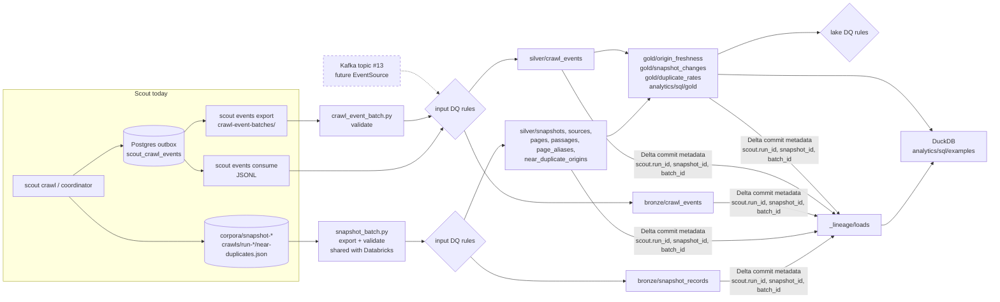

# Local lakehouse: Delta tables, DuckDB queries, data quality

A local, open-source analytics path next to the Databricks pipeline ([Phase 2](phase2.md)),
added for [issue #14](https://github.com/lifrocszh/scout/issues/14). It lands Corpus snapshots and
durable crawl events as Delta tables on the local filesystem, answers questions with DuckDB, and
checks the data with rules that fail loudly. You need Python 3.11+ and three pip packages. It needs no
server, cloud account, MinIO or Databricks workspace. Databricks becomes optional.

```bash
python3 -m pip install -r analytics/requirements.txt   # deltalake, duckdb, pyarrow (pinned)
python3 -m analytics.lakehouse demo                    # fixture crawl -> tables -> checks -> queries
```

`demo` loads the committed fixture crawl into a temporary lake and runs every quality rule. It
then loads the fixture a second time and fails if that adds any row. Last, it prints the example
queries. `demo --broken <kind>` breaks the fixture on purpose and must exit 1. CI runs both.

| Where | What |
| --- | --- |
| `analytics/lakehouse/sources.py` | Inputs: snapshots (through the shared Databricks batch exporter and validator) and crawl-event transports |
| `analytics/lakehouse/transform.py` | Inputs to Bronze/Silver rows (pure) |
| `analytics/lakehouse/quality.py` | The data-quality rules |
| `analytics/lakehouse/tables.py` | Table layout, schemas, insert-only Delta merges |
| `analytics/lakehouse/load.py` | Load order, Gold refresh, lineage |
| `analytics/lakehouse/query.py` | DuckDB over the Delta tables |
| `analytics/sql/gold/*.sql` | The Gold tables, as committed SQL |
| `analytics/sql/examples/*.sql` | Example queries |
| `analytics/fixtures/` | The fixture crawl ([README](../analytics/fixtures/README.md)) |
| `analytics/tests/test_lakehouse.py` | Tests (about 25 s) |

## Why Delta (delta-rs) and not Iceberg

- **Same format as the Databricks path.** The Databricks notebooks already write Delta. The
  local tables use the same format, so Spark or Databricks can read them, and the same reader
  works for both.
- **No catalog.** A Delta table is a directory plus its `_delta_log`. Iceberg needs a catalog
  even locally (pyiceberg with a SQLite or filesystem catalog), which is one more moving part to
  set up and keep consistent.
- **Idempotent merges are built in.** delta-rs `MERGE ... WHEN NOT MATCHED INSERT` is what makes
  reloads add nothing, and a merge that inserts nothing commits no version. pyiceberg's upsert
  support is newer and narrower.
- **Lineage in the commit.** Every Delta commit carries `scout.*` custom metadata (crawl run,
  snapshot, batch, load ID). That is the source of the lineage table.
- **One wheel.** `deltalake` ships the Rust engine, so the install has no JVM and no system
  packages.

DuckDB reads the tables through delta-rs: `query.connect()` registers each current table version
as a view. No DuckDB extension is downloaded, so this also works offline.

## Inputs

All inputs exist today. Nothing depends on Kafka.

| Input | Command | Becomes |
| --- | --- | --- |
| A sealed Corpus snapshot in a data directory | `load-snapshot --data-dir D [--snapshot-id S]...` | Bronze snapshot records, Silver snapshots/sources/pages/passages/aliases |
| A published snapshot batch (`scripts/databricks/snapshot_batch.py export`) | `load-snapshot --batch-dir B [--near-duplicates F]` | same |
| The crawl's `crawls/<run>/near-duplicates.json` (#12) | read with the snapshot (data directory input) | `silver_near_duplicate_origins` |
| `scout events consume` output | `load-events --jsonl F` (`-` reads stdin) | Bronze and Silver crawl events |
| `scout events export` batches | `load-events --batch-dir crawl-event-batches/` | same |

Snapshots go through the exporter and validator in `scripts/databricks/snapshot_batch.py`, and event
batches through `crawl_event_batch.py`. The two paths therefore accept and reject the same inputs:
checksums, publication markers, canonical IDs, counts.

Dead letters (#12) live in Postgres as `failed` task rows and are not loaded yet. `scout dlq list`
prints them as JSON, and a loader for that output would be another small source.

### Adding a transport (Kafka, #13)

Event sources implement one method: `EventSource.records()` yields `CrawlEventRecord`s. Each record
holds the serialized `CrawlEvent` (`{"event_type": ..., "data": {...}}`, the exact payload of
`src/distributed/events.rs`), a transport name and a reference (file:line, batch:line). A Kafka
source would yield the topic's message values as payloads, with
`topic/partition/offset` as the reference. Loading, the quality rules and the tables stay the same.
Delivery may be at least once. Events deduplicate on `(crawl_run_id, event_id)` across all
transports. The same event with a different payload fails `event.identity`.

## Tables

`<lake>/<layer>/<table>`, default lake `data/lakehouse` (ignored by git). DuckDB view names are
`<layer>_<table>`.

| Table | Key | Rows |
| --- | --- | --- |
| `bronze/snapshot_records` | batch, record type, record ID | Every envelope of the snapshot batch, raw JSON (same envelope as `scout_bronze_records` in Databricks) |
| `bronze/crawl_events` | run, event ID | Raw event payloads, payload checksum, transport and reference |
| `silver/snapshots` | snapshot | One row per snapshot: run, batch, times, counts, checksums, stop reason |
| `silver/sources` | snapshot, source | Source scope per snapshot |
| `silver/pages` | snapshot, page | Page ID, Source, Origin, URL, content and body checksums, content length (no Page text) |
| `silver/passages` | snapshot, passage | Passage ID, Page, ordinal, heading path, checksum |
| `silver/page_aliases` | snapshot, alias page | Exact-duplicate aliases and their representative Page |
| `silver/near_duplicate_origins` | snapshot, origin | Per-origin counts from `near-duplicates.json` |
| `silver/crawl_events` | run, event ID | Typed events: type, time, Source, snapshot, counts |
| `gold/origin_freshness` | origin | Newest snapshot and newest capture per Origin |
| `gold/snapshot_changes` | snapshot, source | Pages added, removed, changed and unchanged since the Source's previous snapshot, with change and churn rates |
| `gold/duplicate_rates` | snapshot, origin | Exact-duplicate (alias) and near-duplicate rates |
| `_lineage/loads` | table, version | Which run, snapshot, batch or input produced each table version |

Bronze and Silver are insert-only. Gold is rebuilt from `analytics/sql/gold/*.sql` whenever the
Silver versions it was built from change. The Gold SQL uses portable SQL (window functions, CTEs,
`CAST`) and no DuckDB-only functions, so it can run on Databricks SQL against tables with the same
names.

## Load and query

```bash
LAKE=data/lakehouse
python3 -m analytics.lakehouse load-snapshot --lake $LAKE --data-dir ./data            # every snapshot, oldest first
python3 -m analytics.lakehouse load-snapshot --lake $LAKE --data-dir ./data --snapshot-id snapshot-<hex>
scout events consume --run-id "$RUN_ID" --consumer-id lakehouse-v1 --follow \
  | python3 -m analytics.lakehouse load-events --lake $LAKE --jsonl -
python3 -m analytics.lakehouse load-events --lake $LAKE --batch-dir ./data/crawl-event-batches
python3 -m analytics.lakehouse check --lake $LAKE --freshness-sla-hours 24
python3 -m analytics.lakehouse query --lake $LAKE                                       # the example queries
python3 -m analytics.lakehouse query --lake $LAKE --sql "SELECT COUNT(*) FROM silver_pages"
python3 -m analytics.lakehouse query --lake $LAKE --file my-query.sql
```

Exit codes: 0 ok, 1 a quality rule failed, 2 bad input (for example a missing, unpublished or
corrupt batch). Run one loader per lake at a time. To read the tables from the DuckDB CLI
instead, use its `delta` extension (it downloads once): `SELECT * FROM delta_scan('data/lakehouse/silver/pages')`.

Example queries (`analytics/sql/examples/`), with their output on the fixture:

```sql
-- change_rate.sql: what changed in each Source since its previous snapshot
SELECT source_id, snapshot_id, previous_snapshot_id, pages, added, removed, changed, unchanged,
       ROUND(change_rate, 3) AS change_rate, ROUND(churn_rate, 3) AS churn_rate
FROM gold_snapshot_changes WHERE previous_snapshot_id IS NOT NULL ORDER BY source_id, snapshot_id;
```

```
source_id  pages  added  removed  changed  unchanged  change_rate  churn_rate
docs       4      1      1        2        1          0.667        0.800
reference  3      1      1        1        1          0.500        0.750
```

```sql
-- duplicate_rate.sql: exact and near-duplicate share per Origin in the newest snapshot
SELECT d.origin, d.pages, d.exact_duplicate_aliases, ROUND(d.exact_duplicate_rate, 3) AS exact_duplicate_rate,
       d.near_duplicate_pages, ROUND(d.near_duplicate_rate, 3) AS near_duplicate_rate
FROM gold_duplicate_rates AS d
JOIN gold_origin_freshness AS f ON f.origin = d.origin AND f.latest_snapshot_id = d.snapshot_id;
```

```
origin                  pages  exact_duplicate_aliases  exact_duplicate_rate  near_duplicate_pages  near_duplicate_rate
http://127.0.0.1:18111  4      0                        0.000                 1                     0.250
http://127.0.0.1:18112  3      1                        0.250                 0                     0.000
```

`freshness_by_origin.sql` gives the age of each Origin's newest snapshot and capture. `lineage.sql`
lists every table version with the run and snapshot that produced it. Silver can be queried
directly too, for example Pages whose content changed between two snapshots:

```sql
SELECT cur.normalized_final_url
FROM silver_pages AS cur
JOIN silver_pages AS prev ON prev.page_id = cur.page_id AND prev.content_sha256 <> cur.content_sha256
WHERE cur.snapshot_id = 'snapshot-<new>' AND prev.snapshot_id = 'snapshot-<old>';
```

## Data-quality rules

Input rules run on the staged rows before anything is written, so a broken snapshot or event set
writes nothing. Lake rules run over the loaded tables after every load and with `check`. Any
failure prints every failing rule with examples and exits 1.

| Rule | Fails when |
| --- | --- |
| `schema.drift` | A Page, Passage or alias record has a field the lakehouse does not know, or lacks one it expects. Update `transform.SNAPSHOT_RECORD_FIELDS` and the table schema together |
| `schema.types` | A value does not fit the table's Arrow type |
| `not_null.required_columns` | A key or required column is null or empty |
| `unique.keys` | A key repeats in the input (for example a Page twice in one snapshot) |
| `counts.match_snapshot` | Page, Passage or alias rows differ from the snapshot manifest and batch manifest counts |
| `referential.pages` | A Passage or alias points at a Page that is not in the snapshot, or a Page at an unknown Source |
| `lineage.near_duplicates` | The near-duplicate report belongs to another snapshot or run, or its per-origin Page counts disagree with the snapshot |
| `immutable.snapshot` | A snapshot ID that is already loaded arrives with a different snapshot manifest |
| `event.schema` | Bad JSON, unknown event type, missing or mistyped field, new field, unsupported schema version, bad timestamp, or a batch envelope that disagrees with its payload |
| `event.identity` | The same `(crawl_run_id, event_id)` arrives with a different payload, within one input or against the lake |
| `unique.page_per_snapshot`, `unique.passage_per_snapshot`, `unique.event` | Duplicate keys in the loaded tables |
| `counts.silver_match_snapshot` | A loaded snapshot has fewer or more Silver rows than its manifest (a partial load) |
| `counts.events_match_snapshot` | A `corpus_snapshot_published` event's counts differ from the loaded snapshot |
| `lineage.every_snapshot_traced` | A loaded snapshot has no lineage row |
| `freshness.sla_<h>h` | An Origin's newest snapshot is older than `--freshness-sla-hours` (as of `--as-of`, default now) |

Snapshot IDs are content-derived, so another crawl run can publish the same snapshot again.
`counts.events_match_snapshot` compares counts, not runs.

## Idempotency and lineage

A reload of the same snapshot (as a data directory or as a batch) or of the same events (from any
transport, any number of times) inserts nothing and creates no table version. The tests and `demo`
check this. `silver_snapshots` is written last in a snapshot load, so a listed snapshot has all its
rows. A load that stops partway is completed by running it again. Gold is rebuilt when its recorded
Silver input versions do not match the current ones, which also covers a load that stopped before
Gold.



Each Delta commit records `scout.load_id`, `scout.run_id`, `scout.snapshot_id`, `scout.batch_id`,
`scout.input_kind` and `scout.input_ref`. Gold commits record `scout.silver_versions`, the Silver
table versions they were built from. `_lineage/loads` is rebuilt from that commit metadata after
every load, so a load that stops between a commit and its lineage row is repaired by the next one.
To trace a number back to its crawl, look up the Gold version's Silver inputs, and then the
snapshot and run of each Silver version (`analytics/sql/examples/lineage.sql`). `DeltaTable(path).history()` shows the
same metadata.

## Relation to the Databricks path

| Databricks (`scripts/databricks/`) | Local lakehouse |
| --- | --- |
| `snapshot_batch.py export` / `validate` | the same functions, imported |
| `crawl_event_batch.py validate` | the same function, imported |
| `scout_bronze_records` | `bronze/snapshot_records` (same envelope fields) |
| `scout_silver_records` | `silver/pages`, `passages`, `page_aliases`, ... (one table per record type) |
| `scout_crawl_event_records` / `_identity` | `bronze/crawl_events` / `silver/crawl_events` |
| `gold_snapshot_count_report` | `counts.match_snapshot` and `counts.silver_match_snapshot` |
| Unity Catalog Volume, serverless job | local directory, a Python process |

The Databricks path keeps its own history, tombstone and reconciliation features
([snapshot history](databricks/snapshot-history.md)). The lakehouse does not reproduce them.

## Limits

- Tables are read into memory for DuckDB. That is fine for per-snapshot metadata (no Page bodies
  or text are stored), but it is not meant for very large lakes. DuckDB's `delta_scan` streams
  instead.
- One loader per lake at a time. Delta's optimistic commits protect each table, but the
  load order across tables assumes a single writer.
- Capture events carry a Source, not a URL. `gold_origin_freshness.latest_capture_at_utc`
  attributes each capture to every Origin of its Source.
- `analytics/fixtures/events.jsonl` is derived from the two local crawls' manifests, because a
  local crawl has no outbox. `analytics/fixtures/outbox/` is real `scout events consume` and
  `scout events export` output from a distributed crawl, and the tests load it as well.
